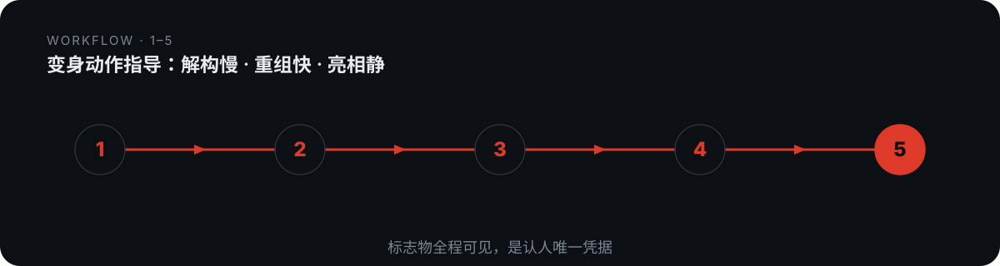

# domn-film-henshin-director


> 变身动作指导：解构慢 · 重组快 · 亮相静。

## 是什么

变身动作指导：解构慢 · 重组快 · 亮相静。本仓库是一个 Agent 技能（SKILL.md 为唯一权威定义），把上面的方法论沉淀为可被对话触发的可执行流程。

## 怎么做（工作流）

<p align="center">
  
</p>

1. **T 判定**
2. **A 定锚点**
3. **B 排四拍**
4. **C 配语法**
5. **S 成稿**

## 怎么用

将本仓库放入支持 `SKILL.md` 的 Agent 技能目录：

- **WorkBuddy**：`~/.workbuddy/skills/domn-film-henshin-director/`
- **Codex / 其他**：对应 skills 目录

然后在对话中触发，例如：

```
用 domn-film-henshin-director 帮我处理一段需求。
```

## 依赖

纯提示词方法论 + references/ 弹药库；出图依赖视频生成模型.

## 仓库结构

```
domn-film-henshin-director/
├── SKILL.md                 # 技能定义（唯一权威）
├── references/              # 方法论弹药库
├── assets/                  # 模板 / 占位素材
└── assets/readme/           # 本 README 的视觉资产（hero.webp / workflow.svg）
```

## 许可

本仓库内容以 `SKILL.md` 为唯一权威定义。如附带 `LICENSE` 文件，以其为准。

---

*README 由 `beautify-github-readme` 生成 · 封面图来自作者作品集，强调色由封面图采样派生。*
